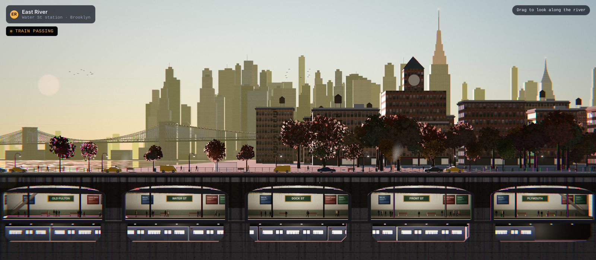
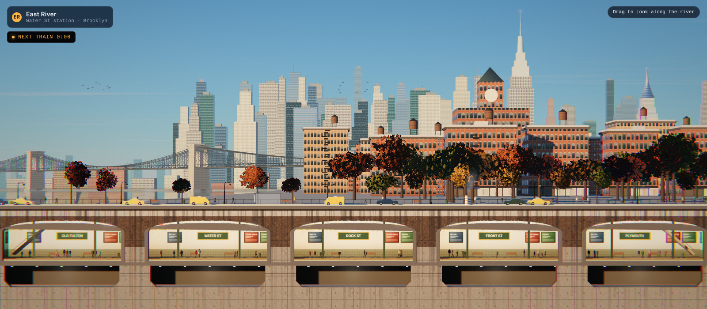
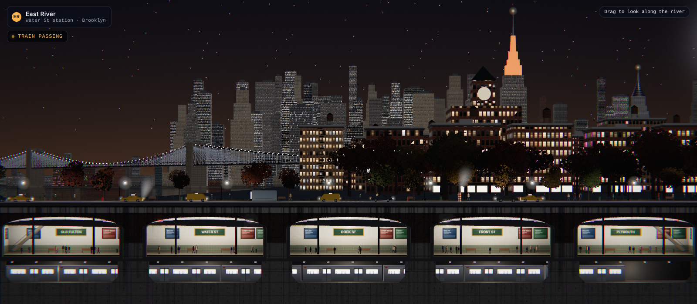
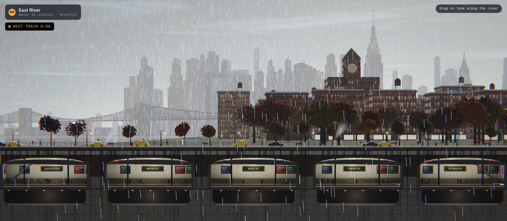
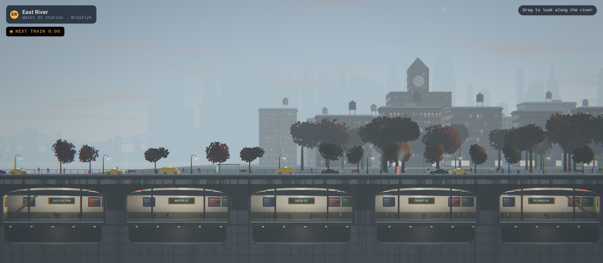
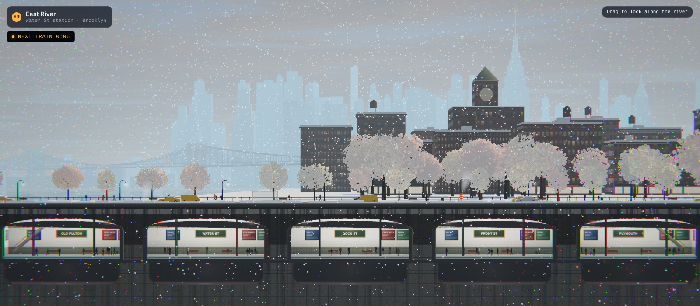

# iso-nyc — East River Diorama

A photoreal, real-time Three.js scene of the Manhattan skyline seen from the Brooklyn waterfront, with the Brooklyn Bridge, a promenade, DUMBO lofts, and a cut-away subway station underneath. Everything is modeled in meters and shot with a telephoto, shifted-lens camera 300 m back, so scale and haze behave like a photograph.



## Controls

- **Time of day** – a 24-hour scrubber (track painted with the actual sky colors), quick jumps for dawn / morning / noon / golden hour / dusk / night, and play/pause. Sunrise and sunset use the real late-October NYC times.
- **Weather** – clear, clouds, rain, snow, fog, thunderstorm. Conditions blend into each other; snow builds up over time on roofs, cars and curbs and melts away again.
- Drag to pan along the river on narrow screens; mouse movement adds a little parallax on desktop.

## What's in the scene

- Physically based sky (Preetham scattering) driving the sun color, ambient light, fog and reflections. Twilight, stars, moon, city glow and projected cloud layers blend on top.
- Planar-reflected river with wave distortion, sun glitter and rain rings.
- Procedural facades (curtain wall, limestone, prewar masonry, brick lofts) with parallax-occluded window reveals, blinds and curtains, and per-building window lighting at night.
- Landmarks: Empire State (orange for Halloween week), Chrysler crown, One World Trade Center, the Brooklyn Bridge with its cable web, and a DUMBO clock tower.
- Street life: taxis, sedans, an NV200 cab and an MTA bus; pedestrians with umbrellas in rain; Bishop's-crook lamps; benches, hydrants, crosswalks, a bus shelter and a Con Ed steam stack; autumn trees with dense leaf clusters.
- Subway cut-away: five tiled platforms lit only by their fluorescent fixtures, a stainless-steel train that runs every 10–20 s, a track pit with ballast and rails, and a geological section through asphalt, concrete and earth.
- River and air traffic: NYC Ferry, water taxi, tug and barge, a jet with nav strobes, a helicopter, bird flocks.

## Renders

| Morning | Night |
| --- | --- |
|  |  |

| Rain | Fog | Snow |
| --- | --- | --- |
|  |  |  |

## Running it

It is a single `index.html`. Open it directly, or serve the folder with any static server:

```sh
npx serve .
```

Dependencies (three r128 plus its EffectComposer, UnrealBloomPass and Reflector helpers) load from CDN.

## Notes

- Heavy scene: bloom, planar reflection, soft shadows and parallax mapping. Older phones will run it slowly; the control panel collapses with the arrow button so the subway is visible on narrow screens.
- Built with Three.js r128. Nothing to compile.
